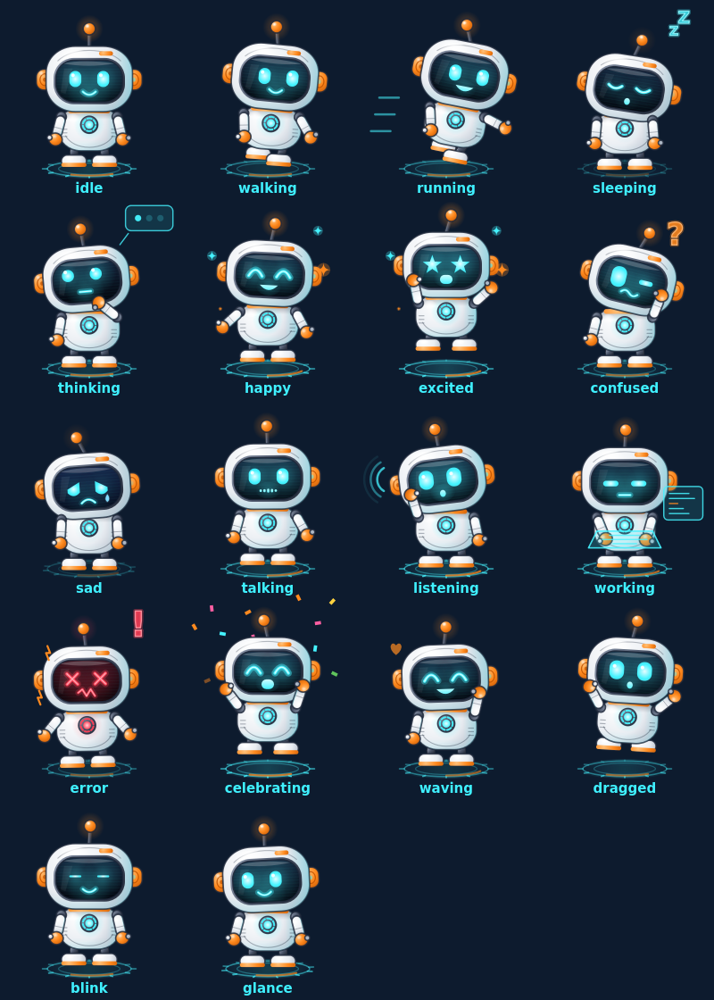

# Kings (NYXO engine)

**Your desktop. Your companion. Your AI.**

**Kings** is an animated AI desktop companion (built on the NYXO engine — internal names like the `nyxo` command and folders stay the same) for Ubuntu (GNOME, Wayland). A small
white robot with orange accents and glowing cyan eyes hovers over a holographic
projector pad on your desktop. It walks around, blinks, glances about, naps
when you're away, and talks to you in a natural British voice. It acts as a
JARVIS-style assistant: it opens apps, finds files, reports system status,
helps with Git and Python, keeps tasks and reminders, warns you before your
battery dies, and tells you which app just sent you a notification (it never
reads the message). NYXO stays on screen even on an empty desktop or after
"Show Desktop", and on every workspace.



## Install

```bash
cd ~/Documents/PROJECTS/NYXO
scripts/install.sh            # no sudo needed
```

The installer copies NYXO to `~/.local/opt/nyxo`, creates a private Python
environment, adds a launcher (`~/.local/bin/nyxo`) and an app-grid entry, and
downloads the voice (63 MB) and speech-recognition (40 MB) models if they're
missing. It also enables a systemd user service so NYXO starts every time you
log in, then starts NYXO. Re-run it any time to update. Your data is kept.

Uninstall: `scripts/uninstall.sh` (keeps your data) or `scripts/uninstall.sh --purge`.

## Use

| Do this | To |
|---|---|
| Double-click NYXO | open the chat |
| Click NYXO | get a reaction / wake it |
| Right-click NYXO (or the tray icon) | menu: chat, talk, focus mode, pause, hide, settings, quit |
| Drag NYXO | move it (it drops back to the bottom of the screen) |
| 🎤 in chat / "Talk to NYXO" | push-to-talk |

Just say **“Kings, …”** (or “Hey Kings, …”) to talk hands-free. Try: `status report`, `pause the music`, `what's playing`, `free up disk space`, `open firefox`, `find *.pdf in downloads`, `cpu usage`,
`what's using my disk space`, `git status in ~/code/app`, `commit "fix bug"`,
`remind me to stretch in 20 minutes`, `add task review PR`,
`remember that I prefer tabs`, `any notifications?`, `focus mode on`, `help`,
or ask anything.

Command line: `nyxo`, `nyxo --chat`, `nyxo --listen`, `nyxo --settings`,
`nyxo --hide/--show/--toggle`, `nyxo --quit`, `nyxo --status`.

## Voice

* Call **Kings** by name: “Kings, play music from YouTube”, or say “Hey Kings”, pause, then ask.
  Vosk spots the name cheaply; the sentence must *start* with the name (so “the king is…” or
  “kingdom” don't trigger). Whisper (base.en, offline) then writes down what you said.
* Replies are spoken with a natural British voice (Piper) with lip-sync.

## Look

The default avatar is the **Kings** portrait, built from your character sheet with
`scripts/build_avatar.py ~/Downloads/kings.jpeg`. It's stored privately in
`~/.local/share/nyxo/avatars/kings/` because the artwork is ©YORUHARE: fine for your own
desktop, but get the artist's permission before sharing it. Settings → Character switches back to
the built-in robot.

## AI

Settings → **AI providers**. NYXO works without AI: every command above is
handled locally. For conversation:

* **Ollama (local, private, default):** `scripts/install_ollama.sh` installs a working CPU runtime
  in `~/.local/opt/ollama` without sudo. model `qwen2.5:1.5b`. NYXO starts
  `ollama serve` when first needed and stops it on quit.
* **Anthropic Claude** or any **OpenAI-compatible** endpoint: paste the API key
  in Settings (stored in `~/.config/nyxo/credentials.env`, mode 600) or set
  `ANTHROPIC_API_KEY` / `OPENAI_API_KEY`.

## Files

| What | Where |
|---|---|
| App | `~/.local/opt/nyxo/` |
| Settings, API keys | `~/.config/nyxo/` |
| Database, models, backups | `~/.local/share/nyxo/` |
| Logs | `~/.local/state/nyxo/logs/nyxo.log` · `journalctl --user -u nyxo -e` |
| Autostart | `~/.config/systemd/user/nyxo.service` |

## Develop

```bash
python3 -m venv .venv && .venv/bin/pip install -r requirements-dev.txt
.venv/bin/python scripts/generate_sprites.py      # re-bake artwork
.venv/bin/python -m pytest                        # tests
NYXO_NO_SYSTEMD=1 .venv/bin/python -m nyxo -v     # run from source
```

See `docs/ARCHITECTURE.md`, `docs/WAYLAND.md`, `docs/VOICE.md` and
`DEVELOPMENT_STATUS.md`. MIT licence.
